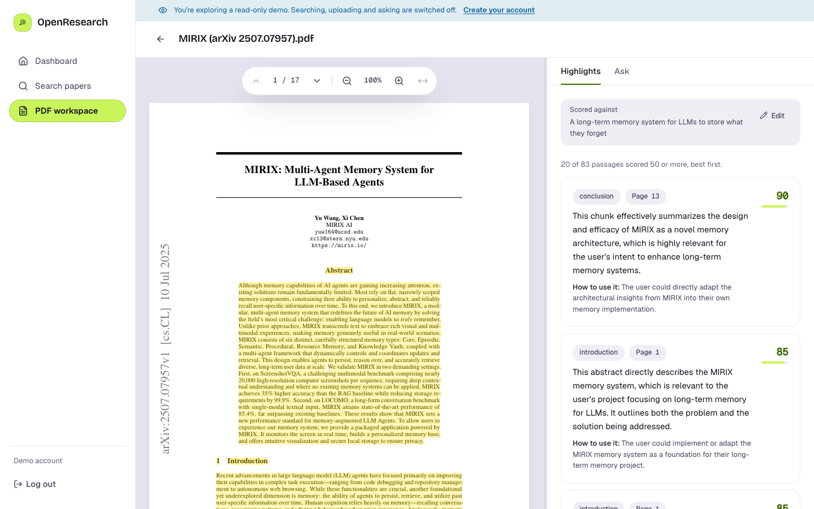
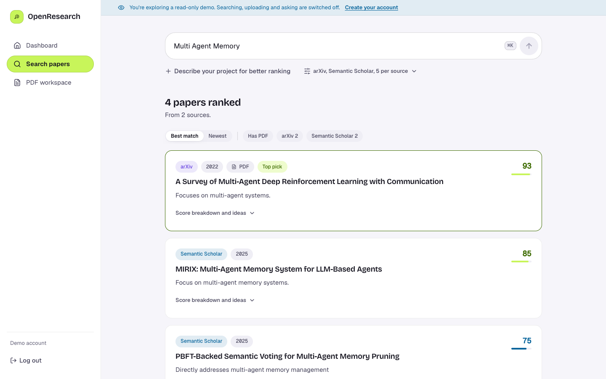
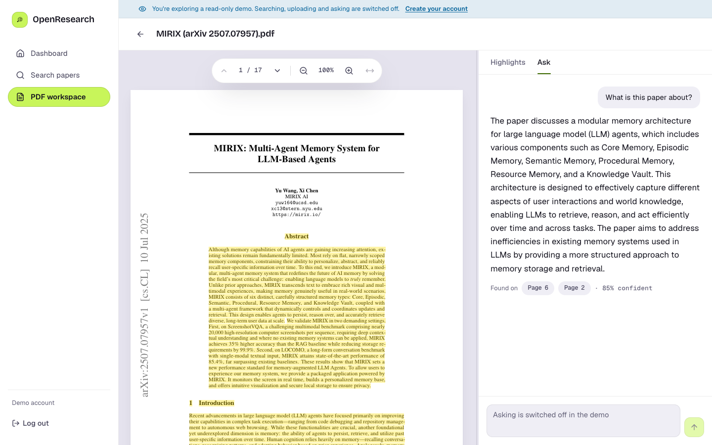
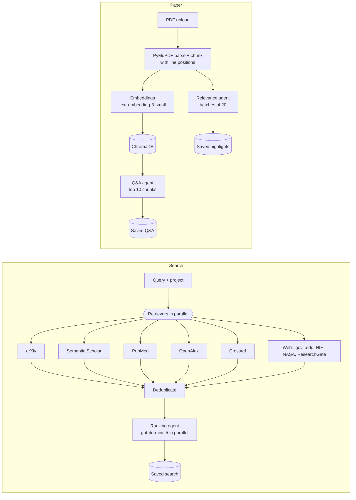

# OpenResearch

[](https://github.com/Webs4Dev/open-research/actions/workflows/ci.yml)
[](LICENSE)

**Research that starts with your project.** OpenResearch searches six academic sources at once,
scores every paper against what you are building, and then lets you read a paper with the passages
that matter to you highlighted in the PDF and ask it questions.



---

## Why

Search tools return lists of papers ranked by keywords and citations. They don't know what you are
working on, so you still read abstracts and skim PDFs to find the few pages you need.
OpenResearch puts your project description at the centre of each step:

1. **Find:** one query goes to arXiv, Semantic Scholar, PubMed, OpenAlex, Crossref and selected web
   sources in parallel. Duplicates are merged, keeping the copy with the best metadata.
2. **Rank:** an LLM scores each paper on a fixed 100-point rubric and explains the score:
   why it matches, ideas worth taking, and whether the full PDF is available.
3. **Read:** upload a paper and every passage is scored against your project. The relevant ones
   are highlighted in place in the PDF, each with a reason and a suggested use.
4. **Ask:** questions about the paper are answered only from its own text, with the pages the
   answer came from and a confidence score.

Searches, papers, scores and questions are saved to your account, so reopening them costs nothing.

## Features

| | |
|---|---|
|  |  |
| **Search:** pick the sources and results per source, and optionally describe your project. Sort by best match or newest; filter by source or "has PDF". | **Ask:** answers come with "found on" page chips that jump to the page in the PDF. |

- **Explainable ranking:** each score breaks down into topic match (25), project relevance (25),
  research similarity (15), PDF availability (15), recency (10) and potential value (10). Paper facts
  (title, year, source, link) come from the retrievers, never from the LLM.
- **Highlights on the real PDF:** the chunker records the position of every text line, so
  highlights are drawn over the rendered page at any zoom, not matched by text search.
- **PDF viewer built for long papers:** continuous scrolling with lazy page rendering, zoom and
  fit-to-width, a resizable split view, and tabs on mobile.
- **Accounts:** email and password with server-side sessions. All history is per user, and a paper
  can only be opened by the users who uploaded it.
- **Read-only demo:** "Try the demo" on the login page opens a shared account with a real saved
  search and an analysed paper. It can't search, upload or ask, so visitors can never spend API credits.
- **Cost guards:** uploads are capped at 25 MB and 100 pages, and scanned PDFs without a text layer are
  rejected before any embedding or LLM call. Papers already stored are not embedded twice.

## How it works



- **Retrieval:** each source runs in its own thread, and a failing source is reported per source
  instead of failing the search. For web results, an LLM first picks which site types fit the query,
  then DuckDuckGo searches them.
- **Chunking:** text is grouped by PDF block. Headings start new chunks, long blocks split on
  sentences, hyphenated line breaks are joined, and each chunk keeps its line boxes as page fractions.
- **LLM calls:** all agents use JSON mode with Pydantic validation. A batch that returns bad JSON is
  skipped rather than failing the request, and the API returns a clear `502` only when nothing usable
  came back.

## Tech stack

| Layer | Tools |
|---|---|
| Backend | Python 3.14, FastAPI, Pydantic, SQLite (accounts and history) |
| AI | OpenAI `gpt-4o-mini` (ranking, relevance, Q&A, source picking), `text-embedding-3-small` |
| Search and RAG | ChromaDB, PyMuPDF, arxiv, semanticscholar, Biopython (PubMed), OpenAlex and Crossref APIs, ddgs |
| Frontend | React 18, TypeScript (strict), Vite, Tailwind CSS, TanStack Query, Zustand, react-pdf (pdf.js) |
| Quality | pytest, Vitest + Testing Library, ESLint, GitHub Actions |
| Hosting | Netlify (frontend); Render planned for the backend |

## Getting started

**Requirements:** Python 3.12+ (CI uses 3.14), Node 20.19+ (CI uses 22), an OpenAI API key.

```bash
git clone https://github.com/Webs4Dev/open-research.git
cd open-research

# Backend (http://localhost:8000)
python -m venv venv && source venv/bin/activate
pip install -r requirements.txt
cp .env.example .env            # then add your OPENAI_API_KEY
uvicorn backend.main:app --reload

# Frontend (http://localhost:5173), in a second terminal
cd frontend
npm install
cp .env.example .env            # VITE_API_URL=http://localhost:8000
npm run dev
```

Open http://localhost:5173 and create an account, or click **Try the demo**.

### Environment variables

Backend (`.env` in the repo root):

| Variable | Required | Purpose |
|---|---|---|
| `OPENAI_API_KEY` | yes | Ranking, relevance scoring, Q&A and embeddings |
| `EMAIL` | recommended | Contact address sent to arXiv, OpenAlex, Crossref and PubMed (polite API use) |
| `S2_API_KEY` | no | Semantic Scholar key for higher rate limits |
| `PUBMED_API_KEY` | no | NCBI key for higher rate limits |
| `DB_PATH` | no | SQLite file, default `data/openresearch.db` |
| `CHROMA_PATH` | no | ChromaDB folder, default `./chroma_db` |
| `COOKIE_CROSS_SITE` | no | `true` when frontend and backend are on different sites (e.g. Netlify + Render) |
| `DEMO_ENABLED` | no | `false` turns off the read-only demo account (default `true`) |

Frontend (`frontend/.env`): `VITE_API_URL`, the backend URL without `/api/v1`.

## Testing

```bash
pip install -r requirements-dev.txt
pytest                          # 52 backend tests

cd frontend
npm run lint
npm test                        # 20 frontend tests
npm run build                   # type check + production build
```

The backend tests are fully offline. A fake OpenAI client answers every LLM and embedding call, and
each test gets its own SQLite database and in-memory Chroma collection, so the suite never spends
credits and never touches your local data. CI runs all of the above on every pull request.

Scripts that call the live paid APIs are kept apart in `scripts/manual/`; run them by hand from the
repo root with `PYTHONPATH=.`.

## API

FastAPI serves interactive docs at http://localhost:8000/docs. Every route is under `/api/v1`;
everything except `/auth/*` needs a logged-in session.

| Method | Route | What it does |
|---|---|---|
| `POST` | `/auth/register`, `/auth/login`, `/auth/logout`, `/auth/demo` | Sessions (httpOnly cookie) |
| `GET` | `/auth/me` | The current user |
| `GET` | `/sources` | Available retrieval sources |
| `POST` | `/search` | Retrieve, deduplicate, rank and save a search |
| `POST` | `/ingest` | Parse, chunk and embed a PDF |
| `POST` | `/analyze` | Score a PDF's passages against a project description |
| `POST` | `/ask` | Answer a question from one paper |
| `GET` | `/papers/{id}/file` | The stored PDF (owner only) |
| `GET` | `/history/searches`, `/history/papers`, `/history/papers/{id}/analysis`, `/history/papers/{id}/qa` | Saved history |

State-changing requests must send `X-Requested-With: openresearch`, a CSRF guard for the cookie session.

## Project structure

```text
backend/
  api/routes/     auth, search, pdf, history endpoints
  agents/         ranking, project relevance, PDF Q&A, web source discovery
  retrievers/     one module per source, plus the parallel manager and deduplicator
  pdf/            PyMuPDF parsing and the position-aware chunker
  rag/            ChromaDB collection and embeddings
  schemas/        Pydantic models shared by routes and agents
  demo.py         seeds the read-only demo account from demo_data/
prompts/          LLM prompts and scoring rubrics
frontend/src/
  pages/          Login, Dashboard, Search, Workspace, Paper view
  components/     PDF viewer, highlights, Q&A chat, search cards
  api/            typed API client (types mirror backend/schemas)
tests/api/        offline backend tests
scripts/manual/   live-API scripts, run by hand
```

## Security

- Passwords are hashed with scrypt; only a SHA-256 hash of each session token is stored.
- Sessions use httpOnly cookies, and every write requires a custom header that cross-site forms can't send.
- Uploads are checked for size, page count, PDF signature, encryption and text content before processing.
- Users can only reach their own searches and papers; the demo account is enforced read-only on the server.

## Credits

The demo paper is *MIRIX: Multi-Agent Memory System for LLM-Based Agents* by Yu Wang and Xi Chen
([arXiv:2507.07957](https://arxiv.org/abs/2507.07957)), used under
[CC BY 4.0](https://creativecommons.org/licenses/by/4.0/) and redistributed unmodified.
The screenshots above show it.

## License

[MIT](LICENSE) © 2026 Devansh Shah. The demo paper in `backend/demo_data/` keeps its own CC BY 4.0 license.
